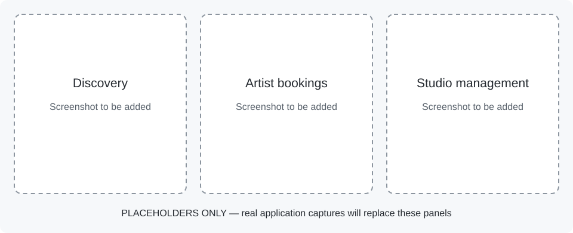

# Inkora — Tattoo discovery and booking

Inkora is a mobile-first marketplace prototype connecting tattoo seekers, artists and studios. It combines discovery and inspiration with booking requests, offers, appointments, real-time messaging and role-specific management tools.

**Status:** MVP in development. React Native/Expo is the primary experience; the Next.js app provides a smaller, partially implemented web experience. Payments, production operations and model-generated tattoo previews are not complete.

## Preview



*Screenshot placeholders only; these panels are not application captures.* See [capture instructions](docs/images/README.md).

## Implemented features and current boundaries

| Area | Current state |
| --- | --- |
| Mobile seekers | Discovery, artist/studio profiles, saved inspiration, booking requests and appointments, chats, notifications and tattoo-journey screens are implemented. |
| Mobile artists | Business Home, requests/offers, availability/calendar and portfolio management are implemented. |
| Mobile studios | Studio Home, Team, applications, calendar, insights and studio editing screens are implemented. |
| Mobile try-on | On-device compositing of an existing artist flash design onto a selected photo is implemented. This is image compositing, not generative AI. |
| Web consumer flows | Authentication/onboarding, feed/discovery, profiles, bookings and messaging have implementations. This is not full mobile parity. |
| Web gaps | The marketing landing page is minimal. Artist/studio dashboards and moderation still include scaffold routes; business-dashboard paths require restructuring. |
| Model-generated previews | The `ai/` package contains an interface and mock service only. Its generated-preview path does not run a model or produce generated images. This is separate from mobile try-on. |
| Production gaps | No integrated payment collection; analytics, push/email configuration and other deployment work remain. See the roadmap. |

These are implementation boundaries, not a claim that every flow has been validated against a freshly provisioned deployment. Open UX findings and deferred capabilities remain visible in [the roadmap](docs/ROADMAP.md).

## Architecture and stack

**React Native · Expo · Next.js · TypeScript · Supabase/PostgreSQL · TanStack Query · pnpm · Turborepo**

```text
apps/mobile/           Primary Expo/React Native application
apps/web/              Secondary Next.js application
packages/domain/       Types, validation and shared business contracts
packages/data-access/  Supabase repositories, queries, realtime and generated DB types
packages/design-tokens/ Shared design values
packages/ui-native/    Native UI components
packages/ui-web/       Web UI components
packages/analytics/    Event contracts and tracker adapters
packages/config/       Shared tooling configuration
supabase/              Migrations, local seed, Edge Functions and staged images
ai/                    Generative-preview interface and mock; no inference
docs/                  Setup, feature backlog, asset guidance and audit history
```

Share domain/data logic across clients; keep rendered native and web UI separate. Database migrations and row-level-security policies are part of the implementation, but their presence alone does not prove a deployed project's access controls are correct.

## Getting started

Prerequisites: Node.js 20+, pnpm **9.12.0**, Docker and the Supabase CLI for a local backend. Native mobile development additionally needs the Android toolchain or macOS/Xcode for iOS. The committed Expo SDK/native dependencies require a compatible native build; do not assume Expo Go supports all modules.

Follow [the setup guide](docs/SETUP.md) for environment-file locations, migrations/seed, storage, native builds, hosted configuration and known bootstrap limitations.

```bash
pnpm install --frozen-lockfile
supabase start
# For a disposable local database only; resets data and applies migrations/seed:
pnpm db:reset
supabase status
```

Create `apps/mobile/.env.local` and `apps/web/.env.local` from the app-specific examples and fill them with your local public URL/anon key. A physical device needs a reachable host URL, not the computer's `localhost`. Keep server/service-role credentials out of both client applications.

```bash
# Requires the running local Supabase instance; review generated changes:
pnpm gen:types

# Native mobile development (Android example):
pnpm --filter @inkora/mobile android

# Web, in another terminal:
pnpm dev:web
```

`pnpm dev:mobile` starts Metro for an already compatible installed build. It does not by itself compile the custom native modules. Existing EAS profiles contain the author's public Supabase configuration; replace those values for your environment before making a hosted build.

## Checks and CI

```bash
pnpm lint
pnpm typecheck
pnpm test
```

[CI already exists](.github/workflows/ci.yml) and runs these checks on main pushes and pull requests. View [workflow results](https://github.com/StefanosTheos/Inkora/actions/workflows/ci.yml). CI does not currently validate a fresh Supabase bootstrap, native build, complete Next.js production build or end-to-end marketplace flows.

Keep `pnpm-lock.yaml`, migrations, sanitized environment examples, tests, required assets and `packages/data-access/src/db/database.types.ts` tracked. Generated runtime/cache output is excluded separately.

## Documentation and roadmap

- [Mobile application](apps/mobile/README.md)
- [Web implementation and gaps](apps/web/README.md)
- [Setup and deployment configuration](docs/SETUP.md)
- [Maintained roadmap](docs/ROADMAP.md)
- [Asset locations](docs/ASSETS.md) and [rights review](THIRD_PARTY_NOTICES.md)
- [Generative-preview mock boundary](ai/README.md)

## Rights

Inkora's original code is **proprietary; all rights reserved** by Stefanos Theos. No open-source license is granted. Third-party dependencies and assets retain their own terms; see [LICENSE](LICENSE) and [third-party notices](THIRD_PARTY_NOTICES.md). Public visibility, if enabled, does not grant general permission to reuse the code.
